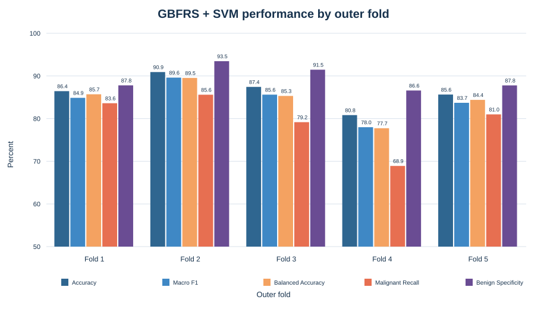

# BUS-BRA Granular Computing

Reproducible experiments for **benign-versus-malignant breast tumour classification** using BUS-BRA radiomic features. Three support vector machine (SVM) approaches are being developed under one patient-grouped evaluation protocol.

> **Status:** All three methods have completed their five-fold evaluations. The paired three-method comparison is pending.

## Approaches

| Approach | Feature selection | Implementation | Evaluation |
|---|---|---|---|
| All-feature SVM | All 288 predictors | [`baseline_svm/`](baseline_svm/) | Five outer folds completed |
| Conventional fuzzy-rough + SVM | Lower-approximation QuickReduct | [`fuzzy_rough/`](fuzzy_rough/) | [Five-fold results](fuzzy_rough/RESULTS.md) |
| **GBFRS + SVM** | Granular-ball fuzzy-rough selection | **[`gbfrs/`](gbfrs/)** | **Five outer folds completed** |

Each method starts from the same 288 predictors, uses the same held-out patients and SVM search space, and follows the [locked evaluation protocol](docs/EVALUATION_PROTOCOL.md).

## GBFRS results

The completed pipeline is `StandardScaler → GBFRSSelector → SVC`. The values below are **mean ± sample standard deviation across five outer folds**, not pooled scores or comparisons with other approaches.

| Measure | GBFRS + SVM |
|---|---:|
| Accuracy | **86.25% ± 3.64%** |
| Macro-F1 | **84.36% ± 4.20%** |
| Balanced accuracy | 84.54% ± 4.27% |
| Malignant recall | 79.65% ± 6.49% |
| Benign specificity | 89.42% ± 2.91% |
| Selected features | **23.4 / 288** on average (91.9% reduction) |



The five held-out folds cover **1,875 images from 1,064 patients**; 22–26 features were selected per fold. See the [GBFRS method overview](gbfrs/README.md), [complete results report](gbfrs/PHASE5_FINAL_RESULTS.md), and [aggregate figures](gbfrs/figures/). The GBFRS results alone do not establish whether feature selection improves on the all-feature baseline.

## Evaluation design

- **Frozen features:** 288 numeric `original_*` and `wavelet-*` predictors; diagnosis labels `0 = benign`, `1 = malignant`. Identifiers, pathology metadata, and fold columns are excluded from the model inputs.
- **Outer evaluation:** five predefined patient-disjoint test folds (`fold5_kfold`); every image receives exactly one held-out prediction.
- **Inner tuning:** three-fold `StratifiedGroupKFold` on the outer-training patients, seed `42 + outer_fold`; macro-F1 selects the parameters.
- **Shared search:** 32 SVM candidates varying `C`, kernel, class weights and RBF gamma.
- **Leakage control:** scaling and any feature selection are fitted only on training partitions within cross-validation.

The protocol identifier is `BUSBRA-V1-OUTER5-INNER3-MACROF1`. This is **research software, not a medical diagnostic system**.

## Repository guide

| Path | Contents |
|---|---|
| [`gbfrs/`](gbfrs/) | GBFRS selector, SVM pipeline, fold runner, mathematical notes and figures |
| [`baseline_svm/`](baseline_svm/) | All-feature SVM team workspace |
| [`fuzzy_rough/`](fuzzy_rough/) | Conventional QuickReduct selector, nested SVM runner and five-fold results |
| [`docs/`](docs/) | Dataset provenance, experimental protocol and submission format |
| [`evaluation/`](evaluation/) | Frozen evaluation contract |
| [`tests/`](tests/) | Synthetic algorithm, pipeline, reproducibility and leakage tests |
| [`CONTRIBUTING.md`](CONTRIBUTING.md) | Contribution workflow and data-handling rules |

## Installation and tests

The verified experimental environment used **Python 3.11.15** and the pinned packages in [`requirements.txt`](requirements.txt). From the repository root:

```bash
git clone https://github.com/Granular-Breast-Cancer-Team/BUS-BRA-Granular-Computing.git
cd BUS-BRA-Granular-Computing
git switch feature/gbfrs
python3.11 -m venv .venv-busbra
source .venv-busbra/bin/activate
python -m pip install -r requirements.txt
python -m pytest -p no:cacheprovider -q
```

**The synthetic tests do not require the private dataset.** GitHub Actions runs them on pushes and pull requests. A full experiment rerun requires the separately distributed checksum-verified CSV and fresh private output directories; see the [GBFRS reproducibility instructions](gbfrs/README.md#reproducibility).

## Data access and reproducibility

- Dataset: [BUS-BRA](https://zenodo.org/records/8231412).
- Expected local input: `inputs/BUSBRA_features_ready.csv`.
- Frozen SHA-256: `7f22dccf4be1f8920a0e9fbd46ae31ed814f1be138e55dc936b00b76d67324ef`.
- Patient-level predictions, the input CSV, private submission bundles, logs, caches and checkpoints **are not published**. Only aggregate figures and metrics are committed.
- The detailed [dataset contract](docs/DATASET.md), [submission requirements](docs/SUBMISSION_FORMAT.md), and [final results report](gbfrs/PHASE5_FINAL_RESULTS.md) describe the saved evidence and its limitations.

The project has no declared software license at present. Do not assume redistribution rights for the code or source dataset.

## References

1. X. Lian, S. Xia, B. Sang, G. Wang and X. Gao, “[GBFRS: Robust Fuzzy Rough Sets via Granular Ball Computing](https://doi.org/10.1109/TNNLS.2026.3681370),” *IEEE Transactions on Neural Networks and Learning Systems*, 37(10), 5271–5285, 2026. The [2025 preprint](https://arxiv.org/abs/2501.18413) informed the independent implementation; paper/code ambiguities are explained in [the technical note](gbfrs/technical_note.md).
2. W. Gómez-Flores, M. J. Gregorio-Calas and W. Coelho de Albuquerque Pereira, “[BUS-BRA: A breast ultrasound dataset for assessing computer-aided diagnosis systems](https://doi.org/10.1002/mp.16812),” *Medical Physics*, 51(4), 3110–3123, 2024.
