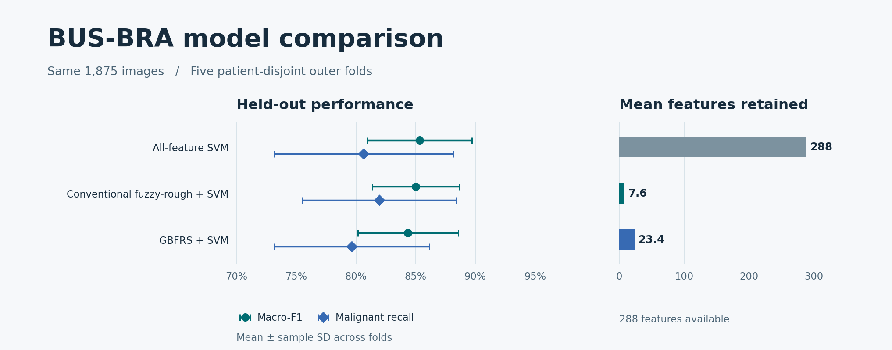

# BUS-BRA final three-method comparison

All three methods were evaluated on the same 1,875 held-out images from 1,064 patients. The comparison uses the five frozen, patient-disjoint outer folds and identical patient group assignments for inner tuning.

## Performance and feature reduction

Scores are the mean ± sample standard deviation across five outer folds, expressed as percentages. Each fold contributes equally. Pooled scores and fold-level aggregates are available in the linked CSVs.

| Method | Accuracy | Macro-F1 | Balanced accuracy | Malignant recall | Benign specificity | Features retained, mean (range) | Reduction |
|---|---:|---:|---:|---:|---:|---:|---:|
| All-feature SVM | 87.14 ± 3.89 | 85.34 ± 4.36 | 85.43 ± 4.54 | 80.63 ± 7.48 | 90.23 ± 3.77 | 288 (all folds) | 0.00% |
| Conventional fuzzy-rough + SVM | 86.73 ± 3.12 | 85.01 ± 3.62 | 85.48 ± 3.95 | 81.96 ± 6.43 | 89.01 ± 1.78 | 7.6 (7–8) | 97.36% |
| GBFRS + SVM | 86.25 ± 3.64 | 84.36 ± 4.20 | 84.54 ± 4.27 | 79.65 ± 6.49 | 89.42 ± 2.91 | 23.4 (22–26) | 91.88% |

Conventional fuzzy-rough selection retained 7.6 features on average and scored 0.33 percentage points below the matched baseline on mean macro-F1. GBFRS retained 23.4 features and scored 0.98 percentage points below the baseline.

## Paired outer-fold results

Each row uses the same held-out images for all three methods. The differences below are in percentage points relative to the all-feature baseline.

| Fold | Images | Baseline macro-F1 | Conventional fuzzy-rough macro-F1 | GBFRS macro-F1 | Conventional Δ | GBFRS Δ |
|---|---:|---:|---:|---:|---:|---:|
| 1 | 376 | 87.65% | 87.02% | 84.87% | −0.64 | −2.79 |
| 2 | 385 | 90.56% | 89.51% | 89.61% | −1.05 | −0.95 |
| 3 | 366 | 84.64% | 84.57% | 85.62% | −0.08 | +0.97 |
| 4 | 365 | 78.80% | 79.78% | 77.99% | +0.98 | −0.82 |
| 5 | 383 | 85.01% | 84.17% | 83.70% | −0.85 | −1.31 |

Fold 4 had the lowest malignant recall for all three methods. Recall there was 73.95% for the all-feature baseline, 73.11% for conventional fuzzy-rough, and 68.91% for GBFRS.

## Reproduction and checks

- The frozen data fingerprint matches the evaluation contract. The team checker validated exact image coverage, patient groups, outer folds, diagnoses and selected feature names for all three submissions. [Evaluation contract](../evaluation_contract.json)
- Each method tuned the shared 32 SVC candidates by mean macro-F1 on three inner folds per outer fold. Group membership was disjoint at both levels. A candidate-score audit confirmed that the winning settings satisfy the prescribed tie-break rules.
- The baseline was rerun using the shared Python 3.11.15 and scikit-learn 1.5.2 environment for this comparison. The baseline's own requirements pin scikit-learn 1.9.1, which produced different inner group assignments with the same seed. A separate run with those pins reproduced the original baseline's reported outer-fold accuracies. [Shared requirements](../../requirements.txt) · [Baseline results](../../baseline_svm/README.md)
- The conventional results are from the verified Member 2 submission. The GBFRS replay reproduced the published fold scores and retained feature counts to the reported precision. [Conventional run](../../fuzzy_rough/RESULTS.md) · [GBFRS run](../../gbfrs/PHASE5_FINAL_RESULTS.md)
- Assemble the three method folders in the original offline handoff and run the unchanged `python tools/compare_results.py` from its root. [Team submission format](../../docs/SUBMISSION_FORMAT.md)

## Runtime and interpretation

Summing the measured times of the five folds gives 20.0 minutes for the matched baseline, 39.7 seconds for conventional fuzzy-rough selection, and 87.2 minutes for GBFRS. The GBFRS sum includes overlapping time across concurrent folds. The conventional run was recorded separately, so timing differences also reflect system load.

Fold standard deviations describe variability across the five folds. The performance differences are descriptive for this single cohort.

[Aggregate summary CSV](comparison_summary.csv) · [Per-fold aggregate CSV](per_fold_metrics.csv)
