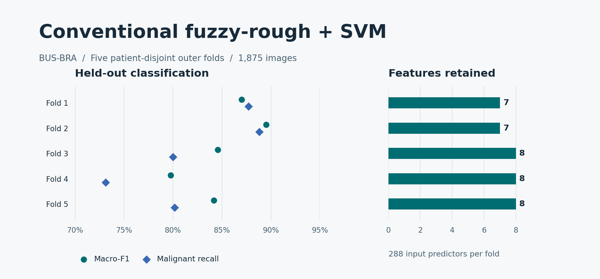

# BUS-BRA five-fold results

Conventional fuzzy-rough selection + SVM reached **85.01% mean macro-F1** and **86.73% mean accuracy** across five held-out folds. QuickReduct retained **7.6 of 288 features on average**, a **97.36% reduction**. The evaluation covered 1,875 images from 1,064 patients.

## Held-out performance

Scores are image-level percentages. The fold mean weights each fold equally, and SD is the sample standard deviation across folds. The pooled row scores all 1,875 predictions together.

| Fold | Images | Features | Accuracy | Macro-F1 | Balanced accuracy | Malignant recall | Benign specificity |
|---|---:|---:|---:|---:|---:|---:|---:|
| 1 | 376 | 7 | 88.30 | 87.02 | 88.14 | 87.70 | 88.58 |
| 2 | 385 | 7 | 90.65 | 89.51 | 90.17 | 88.80 | 91.54 |
| 3 | 366 | 8 | 86.34 | 84.57 | 84.72 | 80.00 | 89.43 |
| 4 | 365 | 8 | 82.19 | 79.78 | 79.85 | 73.11 | 86.59 |
| 5 | 383 | 8 | 86.16 | 84.17 | 84.55 | 80.17 | 88.93 |
| **Mean ± SD** | | **7.6 ± 0.55** | **86.73 ± 3.12** | **85.01 ± 3.62** | **85.48 ± 3.95** | **81.96 ± 6.43** | **89.01 ± 1.78** |
| Pooled | 1,875 | | 86.77 | 85.08 | 85.54 | 82.04 | 89.04 |

Malignant recall varied by 15.69 percentage points across folds, with its lowest value in fold 4. All five outer-training reducts reached the full-set dependency of 1.0 on their training data. The held-out scores show how performance varied on unseen patients. The scope is the frozen BUS-BRA cohort.

## Inner-CV settings and runtime

Each outer fold evaluated all 32 candidates with three patient-grouped inner splits. Every winner used the RBF kernel with balanced class weights. The recorded inner scores guided model selection.

| Outer fold | C | Gamma | Inner macro-F1 | Inner accuracy | Fold runtime |
|---|---:|---|---:|---:|---:|
| 1 | 1 | scale | 83.80% | 85.66% | 8.18 s |
| 2 | 10 | 0.01 | 82.95% | 85.03% | 8.02 s |
| 3 | 100 | 0.01 | 84.89% | 86.49% | 8.25 s |
| 4 | 1 | 0.1 | 87.07% | 88.61% | 7.64 s |
| 5 | 10 | 0.01 | 85.03% | 86.80% | 7.58 s |

The five folds took 39.67 seconds in total on an Apple M2 MacBook Pro with 8 GB RAM and macOS 26.5.2. The run used Python 3.11.15, NumPy 1.26.4, pandas 2.2.3, scikit-learn 1.5.2, SciPy 1.14.1 and joblib 1.6.0.

## Verification

The team checker accepted the method's submission against the frozen CSV, including the full image coverage, image-to-patient mapping, held-out folds, labels and allowed feature names. The test suite checks the paper's six-object example, the SVC tie-break and the four training-only selector fits per outer fold. The paired comparison uses the coordinator's three-method handoff.

[Method and reproduction instructions](README.md)
