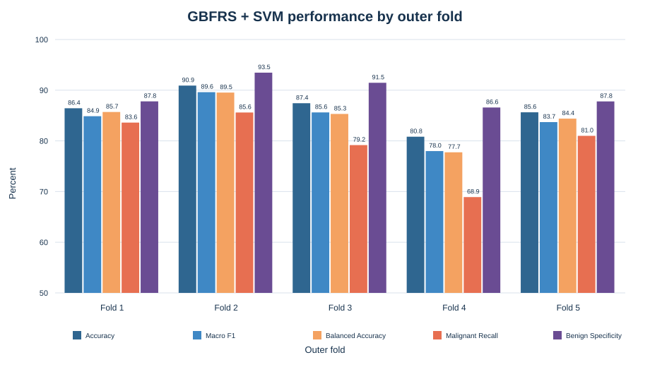
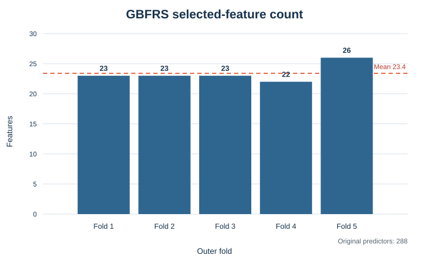
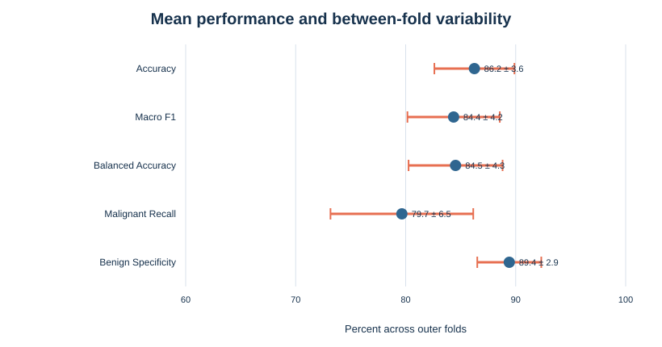
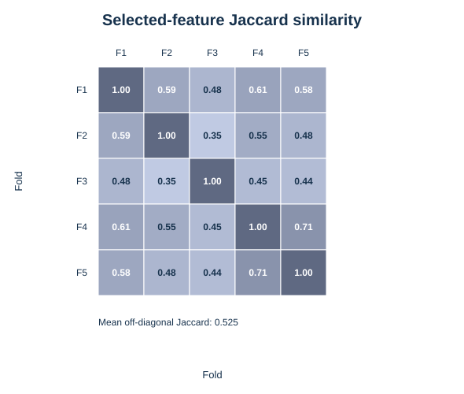

# GBFRS + SVM

Independent implementation of **Granular-Ball Fuzzy-Rough Feature Selection (GBFRS)** and a support vector machine (SVM) classifier evaluated on the BUS-BRA radiomic features.

**Status:** The five-fold GBFRS evaluation is complete. The three-way comparison against the all-feature SVM and conventional fuzzy-rough + SVM is pending the other methods' private submissions. No relative-performance claim is made here.

## Method

```text
StandardScaler → GBFRSSelector → SVC
```

The [selector](selector.py) independently implements granular-ball construction, purity-controlled splitting, heterogeneous-overlap handling, sample-mass weighted fuzzy dependency and greedy feature selection with a **direct strict-improvement stopping rule**. Distances are computed using `scipy.spatial.distance.cdist`.

The implementation follows the paper's mathematical definitions but is **not claimed to be identical to the authors' research code**. The [technical note](technical_note.md) documents differences in the scoring expression, distance parameter, overlap resolution and stopping condition.

## Dataset and evaluation

The frozen `inputs/BUSBRA_features_ready.csv` contains **1,875 images**, **1,064 patients** and **288 numeric radiomic predictors**. The feature matrix includes only `original_*` and `wavelet-*` columns; patient identifiers, metadata, diagnoses and split columns are not predictors. Labels are `0 = benign`, `1 = malignant`.

**Dataset SHA-256:** `7f22dccf4be1f8920a0e9fbd46ae31ed814f1be138e55dc936b00b76d67324ef`

The locked evaluation contract is `BUSBRA-V1-OUTER5-INNER3-MACROF1`:

- Five predefined patient-disjoint outer test folds (`fold5_kfold`).
- Three-fold `StratifiedGroupKFold` for tuning within each outer-training set, grouped by `patient_id`, with random state `42 + outer_fold`.
- Training-partition-only fitting of the scaler and GBFRS selector.
- Selection of SVM parameters using mean inner **macro-F1**.
- The same 32 candidate SVM configurations as the other team methods.

See [the protocol](../docs/EVALUATION_PROTOCOL.md) and [the frozen contract](../evaluation/evaluation_contract.json).

## Five-fold experimental results

All **1,875** outer-test predictions were saved and checked. Summary values are the mean and **sample standard deviation** across five folds; these are not pooled statistics.

| Metric | Mean ± SD |
|---|---:|
| Accuracy | **86.25% ± 3.64%** |
| Macro-F1 | **84.36% ± 4.20%** |
| Balanced accuracy | 84.54% ± 4.27% |
| Malignant recall | 79.65% ± 6.49% |
| Benign specificity | 89.42% ± 2.91% |
| Features selected | **23.4 / 288** |

### Per-fold performance

| Fold | Test images | Features | Accuracy | Macro-F1 | Balanced accuracy | Malignant recall | Benign specificity |
|---:|---:|---:|---:|---:|---:|---:|---:|
| 1 | 376 | 23 | 0.8644 | 0.8487 | 0.8570 | 0.8361 | 0.8780 |
| 2 | 385 | 23 | 0.9091 | 0.8961 | 0.8953 | 0.8560 | 0.9346 |
| 3 | 366 | 23 | 0.8743 | 0.8562 | 0.8532 | 0.7917 | 0.9146 |
| 4 | 365 | 22 | 0.8082 | 0.7799 | 0.7775 | 0.6891 | 0.8659 |
| 5 | 383 | 26 | 0.8564 | 0.8370 | 0.8439 | 0.8099 | 0.8779 |

GBFRS selected **23.4 features on average** (91.9% fewer than 288). Across folds, 41 distinct feature names were selected. The mean pairwise selection-set Jaccard similarity was **0.525**. These are descriptive results for GBFRS alone.

### Visualizations

**Classification performance across folds**



**Selected-feature counts**



**Metric variability**



**Feature-selection stability**



For the selected names, per-fold SVM parameters, runtimes, pooled scores, validation checks and interpretation, read the **[complete five-fold results report](PHASE5_FINAL_RESULTS.md)**.

## Source layout

| File | Role |
|---|---|
| [`selector.py`](selector.py) | GBFRS formulas, ball construction, feature selection and scikit-learn interface |
| [`pipeline.py`](pipeline.py) | Name-preserving scaler → selector → SVC pipeline |
| [`protocol.py`](protocol.py) | Frozen predictors, grouped splits, common SVM grid and metrics |
| [`experiment.py`](experiment.py) | Resumable, checkpointed outer-fold experiment |
| [`run_outer_fold.py`](run_outer_fold.py) | One-fold command-line runner |
| [`submission.py`](submission.py) | Private handoff schema validation |
| [`../tests/`](../tests/) | Synthetic unit and leakage-prevention tests |
| [`technical_note.md`](technical_note.md) | Mathematical decisions and paper/code differences |

Earlier milestone reports are retained as historical development records, while [`PHASE5_FINAL_RESULTS.md`](PHASE5_FINAL_RESULTS.md) contains the completed results.

## Reproducibility

The reference environment used Python **3.11.15**; the specific package versions are pinned in [`../requirements.txt`](../requirements.txt).

```bash
python3.11 -m venv .venv-busbra
source .venv-busbra/bin/activate
python -m pip install -r requirements.txt
python -m pytest -p no:cacheprovider -q
```

The tests use synthetic fixtures and **do not require the private CSV**. For a controlled outer-fold rerun, first place the authorized frozen dataset under `inputs/`, verify its SHA-256, and inspect the runner's exact options:

```bash
python -m gbfrs.run_outer_fold --help
```

Use **new** private output, checkpoint and cache locations rather than writing over the archived folds. Running the full nested protocol is computationally more expensive than running the synthetic tests.

## Limitations and privacy

- These numbers describe **one locked five-fold evaluation**; they are not an external validation study or evidence of superiority to another method.
- The paper's pseudocode and the reference implementation differ in some choices; these are recorded in [`technical_note.md`](technical_note.md).
- The public repository intentionally excludes the frozen CSV, patient-level predictions, local checkpoints, logs, caches and submission ZIP. These private artifacts are required for a fully independent numerical recheck.
- This project is research software, **not a medical diagnostic system**.

## References

1. X. Lian, S. Xia, B. Sang, G. Wang and X. Gao, “[GBFRS: Robust Fuzzy Rough Sets via Granular Ball Computing](https://doi.org/10.1109/TNNLS.2026.3681370),” *IEEE Transactions on Neural Networks and Learning Systems*, 37(10), 5271–5285, 2026. The independent implementation was designed using the [2025 preprint](https://arxiv.org/abs/2501.18413).
2. [Authors' GBFRS reference repository](https://github.com/lianxiaoyu724/GBFRS), consulted as a reference; no source was copied.
3. W. Gómez-Flores, M. J. Gregorio-Calas and W. Coelho de Albuquerque Pereira, “[BUS-BRA: A breast ultrasound dataset for assessing computer-aided diagnosis systems](https://doi.org/10.1002/mp.16812),” *Medical Physics*, 51(4), 3110–3123, 2024.
