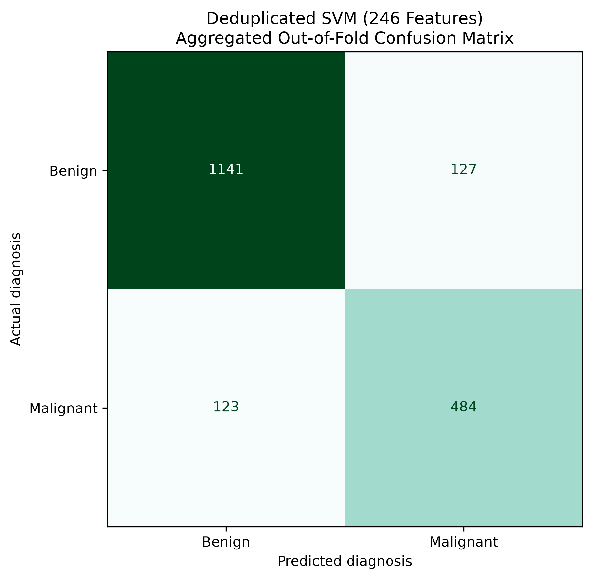
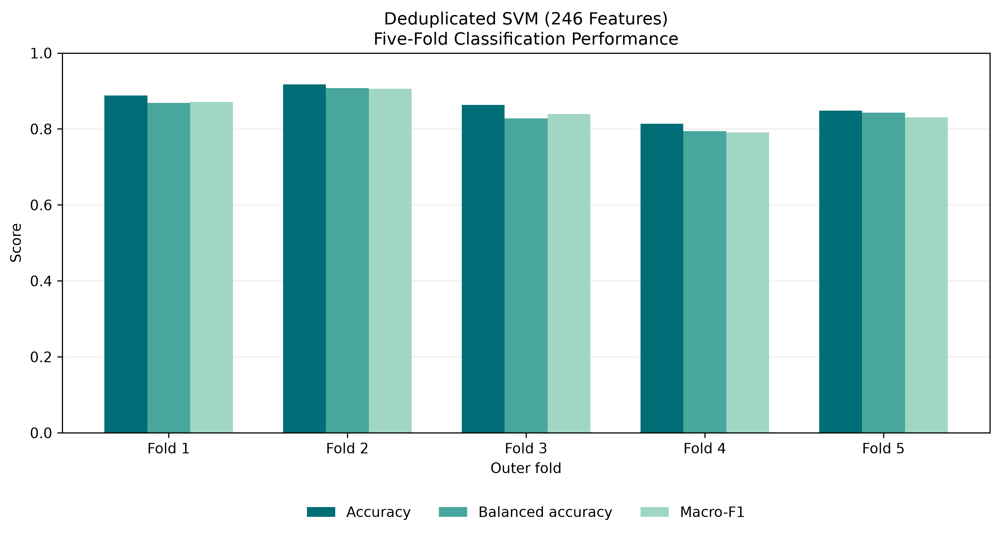
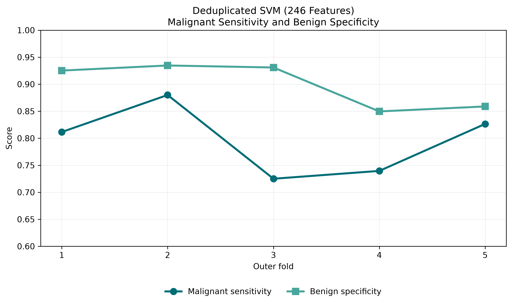
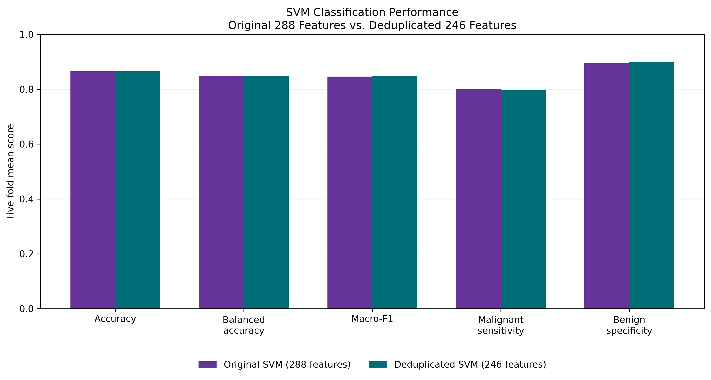

# Deduplicated SVM Experiment (246 Features)


## 1. Objective


This supplementary experiment investigates whether removing exact duplicate radiomic feature columns affects the classification performance of a Support Vector Machine (SVM) on the BUS-BRA dataset.


The experiment extends the original 288-feature SVM baseline by removing redundant feature columns before standardization and model training.


This is an additional experiment and does not replace the three official methods evaluated by the team: all-feature SVM, conventional fuzzy-rough feature selection, and GBFRS.


## 2. Dataset and Feature Deduplication


The experiment uses the frozen BUS-BRA dataset containing 1,875 image records from 1,064 patients, including 1,268 benign images and 607 malignant images.


The initial feature set contains 288 permitted radiomic predictors.


A custom `DuplicateFeatureSelector` identifies columns with exactly identical values in the training data and retains one representative from each group of duplicates.


The completed experiment produced the following results:


| Feature information | Value |

|---|---:|

| Original predictors | 288 |

| Exact duplicate columns removed | 42 |

| Retained predictors | 246 |

| Feature reduction | 14.58% |


Duplicate detection is performed within the training pipeline, including during inner cross-validation. This prevents the selector from learning duplicate relationships using validation or held-out test data.


The method removes exact duplicate columns only. It does not perform conventional fuzzy-rough feature selection or GBFRS.


## 3. Evaluation Methodology


The experiment follows the team's BUS-BRA evaluation protocol.


Five predefined patient-disjoint outer folds are used to evaluate classification performance. Within each outer training partition, three-fold `StratifiedGroupKFold` is used for hyperparameter selection.


The machine-learning pipeline is:


`DuplicateFeatureSelector -> StandardScaler -> SVC`


The SVM search evaluates 32 hyperparameter configurations involving:


\- Linear and RBF kernels

\- Regularization values C = 0.1, 1, 10, 100

\- RBF gamma values of scale, 0.01, and 0.1

\- Class weighting options of None and balanced


Macro-F1 is the primary metric used to select the best model.


After hyperparameter selection, the best pipeline is refitted on the complete outer training partition and evaluated on the corresponding held-out test fold.


All reported classification results are based on image-level predictions with patient-disjoint cross-validation.


## 4. Experimental Results


The following results were calculated from the original saved predictions for the 288-feature baseline and the 246-feature deduplicated SVM.


They are distinct from the separately rerun baseline used in the team's final three-method comparison.


### 4.1 Mean classification performance


| Metric | Original SVM (288) | Deduplicated SVM (246) |

|---|---:|---:|

| Accuracy | 0.8650 | 0.8662 |

| Balanced accuracy | 0.8486 | 0.8481 |

| Macro-F1 | 0.8461 | 0.8475 |

| Malignant sensitivity | 0.8012 | 0.7965 |

| Benign specificity | 0.8960 | 0.8998 |


The deduplicated SVM achieved similar classification performance while using 42 fewer predictors.


Accuracy and macro-F1 increased slightly, while balanced accuracy and malignant sensitivity decreased slightly.


These small differences do not establish that removing exact duplicate columns consistently improves classification performance.


### 4.2 Five-fold results for the deduplicated SVM


| Outer fold | Accuracy | Balanced accuracy | Macro-F1 | Malignant sensitivity | Benign specificity |

|---|---:|---:|---:|---:|---:|

| 1 | 0.8883 | 0.8683 | 0.8715 | 0.8115 | 0.9252 |

| 2 | 0.9169 | 0.9073 | 0.9056 | 0.8800 | 0.9346 |

| 3 | 0.8634 | 0.8279 | 0.8392 | 0.7250 | 0.9309 |

| 4 | 0.8137 | 0.7945 | 0.7907 | 0.7395 | 0.8496 |

| 5 | 0.8486 | 0.8426 | 0.8305 | 0.8264 | 0.8588 |

| \*\*Mean\*\* | \*\*0.8662\*\* | \*\*0.8481\*\* | \*\*0.8475\*\* | \*\*0.7965\*\* | \*\*0.8998\*\* |

| Sample SD | 0.0392 | 0.0425 | 0.0434 | 0.0641 | 0.0419 |


### 4.3 Recorded runtime


The original 288-feature SVM required approximately 574.94 seconds across the five outer folds.


The 246-feature deduplicated SVM required 678.83 seconds.


Although deduplication reduced the feature count, it did not reduce total recorded execution time in this experiment. The deduplication process introduces computational overhead.


Runtime measurements are environment-dependent and should not be interpreted as a controlled hardware benchmark.


## 5. Evaluation Figures


The following figures were generated from the original saved predictions and timing records without retraining the models.


### Figure 1. Aggregated Confusion Matrix





The confusion matrix summarizes 1,875 held-out image predictions across five outer folds.


The classifier correctly identified 1,141 benign images and 484 malignant images. It misclassified 127 benign images as malignant and 123 malignant images as benign.


### Figure 2. Five-Fold Classification Performance





This figure presents accuracy, balanced accuracy, and macro-F1 across the five outer folds.


The performance differences illustrate variation between evaluation folds.


### Figure 3. Malignant Sensitivity and Benign Specificity





This figure compares malignant sensitivity and benign specificity across the five folds.


Malignant sensitivity ranged from 72.50% to 88.00%, while benign specificity ranged from 84.96% to 93.46%.


### Figure 4. Original vs. Deduplicated SVM





This figure compares the original 288-feature SVM and the deduplicated 246-feature SVM using their five-fold mean classification scores.


The results indicate that removing exact duplicate features preserved broadly similar predictive performance.


## 6. Reproduction Instructions


### 6.1 Software environment


The original deduplicated experiment was completed using Python 3.11.9 and the following package versions:


| Package | Version |

|---|---|

| Python | 3.11.9 |

| pandas | 3.0.6 |

| NumPy | 2.4.6 |

| SciPy | 1.17.1 |

| scikit-learn | 1.9.1 |


These versions are documented in `svm_deduplicated/requirements.txt`.


Use a separate Python environment for this experiment because its dependencies differ from the team's shared evaluation environment.


### 6.2 Required inputs


The private BUS-BRA dataset and feature allowlist must be placed in the repository's `inputs/` directory:


\- `inputs/BUSBRA_features_ready.csv`

\- `inputs/allowed_feature_columns.txt`


Both files are distributed through the team's private handoff and must not be committed to the public repository.


Follow the [input instructions](../inputs/README.md) and verify the dataset checksum against the [evaluation contract](../evaluation/evaluation_contract.json).


### 6.3 Install dependencies and execute


From the repository root, using a dedicated Python 3.11 environment, run:


```bash

python -m pip install -r svm_deduplicated/requirements.txt

python svm_deduplicated/svm_deduplicated.py

python svm_deduplicated/summarize_deduplicated.py

```


The experiment saves its outputs to:


`submissions/svm_deduplicated/`


The output files include:


\- `predictions.csv`

\- `best_params.csv`

\- `selected_features.csv`

\- `timings.csv`

\- `run_info.json`


These experimental outputs must remain private.


### 6.4 Regenerate the figures


After placing the saved private predictions in the documented submission folders, the figures can be regenerated from the repository root:


```bash

python svm_deduplicated/make_confusion_matrix.py

python svm_deduplicated/make_fold_metrics.py

python svm_deduplicated/make_sensitivity_specificity.py

python svm_deduplicated/make_baseline_comparison.py

```


The comparison script additionally requires the original baseline predictions at:


`submissions/baseline/predictions.csv`


Generated figures are saved under:


`svm_deduplicated/figures/`


## 7. Limitations


This experiment has several limitations.


First, the evaluation uses only the frozen BUS-BRA dataset. The results have not been validated on an independent external dataset.


Second, although patient groups are separated during cross-validation, evaluation is performed at the image level. Therefore, the findings do not establish clinical readiness.


Third, the custom feature selector removes only columns containing exactly identical values. It does not identify highly correlated, approximately redundant, or otherwise irrelevant features.


Fourth, the reduction from 288 to 246 predictors did not consistently improve classification metrics or recorded runtime.


Finally, this experiment is a supplementary analysis and should not be interpreted as an additional official method in the team's three-method feature-selection comparison.


## 8. Conclusion


The deduplicated SVM experiment reduced the number of radiomic predictors from 288 to 246, representing a 14.58% reduction in feature count.


The classifier maintained similar accuracy, balanced accuracy, and macro-F1 compared with the original all-feature SVM baseline. However, malignant sensitivity decreased slightly, and recorded runtime increased.


These findings suggest that exact duplicate feature removal can reduce input redundancy without substantially changing classification performance in this dataset. Further evaluation would be required to determine whether this preprocessing step offers consistent benefits across other datasets and experimental conditions.


